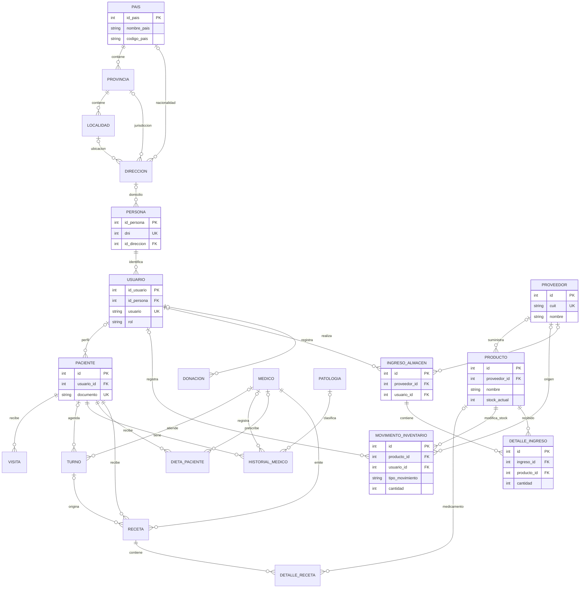

# DER del sistema

Diagrama resumido de las relaciones persistidas principales del esquema SQL.
No representa todas las columnas ni sustituye el script de base de datos.

En el SQL, el rol del usuario se guarda como texto restringido, no como clave
foránea a `roles`. El catálogo `menus`, las habitaciones y los movimientos de
pacientes no aparecen en este resumen. Confirmar las cardinalidades y nombres
contra la versión final del esquema antes de entregar.