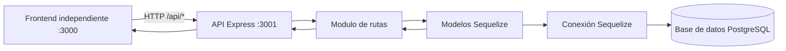

# Arquitectura del Backend

Este proyecto usa una arquitectura simple por capas dentro de Express.

## Flujo general



## Módulos separados

- `auth.router.js`: registro y login.
- `pacientes.router.js`: CRUD de pacientes y búsqueda por DNI/nombre.
- `visitas.router.js`: alta/finalización de visitas y consultas para "mis visitas".
- `cocina.router.js`: dashboard de cocina, menús y dietas.
- `gestion.router.js`: administración de usuarios, personas y roles.
- `almacen.router.js`: inventario, productos, proveedores e ingresos.
- `admin.router.js`: personal, patologías, movimientos, menús y habitaciones.
- `doctor.router.js`: médicos, turnos y donaciones.

Las rutas acceden a la base mediante los modelos Sequelize definidos en `models/`.
Los módulos `*-sequelize.router.js` contienen las implementaciones ORM utilizadas
por las rutas principales; no se ejecutan dos registros de rutas para un mismo
módulo.

## Rol de server.js

server.js ahora cumple 3 funciones principales:

1. Arranque y middleware global:
- Express, CORS y JSON.
- Solo atiende endpoints de la API en el puerto 3001.

2. Inicialización de Sequelize y helpers compartidos:
- Registro y asociación de modelos.
- Helpers de compatibilidad de esquema y seed mínimo.

3. Ensamble de módulos:
- Registra los routers de la API una sola vez.
- Comparte los modelos Sequelize con cada módulo.

## Como explicarlo en la expo

1. "El frontend llama a /api".
2. "Express enruta por modulo".
3. "Cada módulo accede a los datos con modelos Sequelize".
4. "La respuesta vuelve al frontend en JSON".
5. "server.js centraliza config y conecta modulos".

## Estructura y arranque

```text
backend/
    server.js
    routes/
    models/
    database/
frontend/
    server.js
    html/
    js/
    estilo.css
```

Desde la carpeta raíz se levantan por separado:

```bash
npm run backend:start
npm run frontend:start
```

La API queda disponible en `http://localhost:3001` y el frontend en
`http://localhost:3000`.
