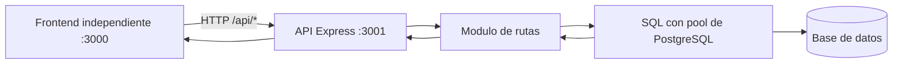

# Arquitectura del Backend

Este proyecto usa una arquitectura simple por capas dentro de Express.

## Flujo general



## Modulos separados (refactor)

- auth.routes.js: registro y login.
- pacientes.routes.js: CRUD de pacientes y busqueda por DNI/nombre.
- visitas.routes.js: alta/finalizacion de visitas y consultas para "mis visitas".
- cocina.routes.js: dashboard de cocina, menus y dietas.

## Rol de server.js

server.js ahora cumple 3 funciones principales:

1. Arranque y middleware global:
- Express, CORS y JSON.
- Solo atiende endpoints de la API en el puerto 3001.

2. Helpers compartidos:
- Deteccion de columnas ID para compatibilidad de esquema.
- Helpers de compatibilidad y seed minimo.

3. Ensamble de modulos:
- Registra rutas extraidas (auth/pacientes/visitas/cocina).
- Mantiene otros modulos que aun estan inline.

## Como explicarlo en la expo

1. "El frontend llama a /api".
2. "Express enruta por modulo".
3. "Cada modulo ejecuta SQL con pool".
4. "La respuesta vuelve al frontend en JSON".
5. "server.js centraliza config y conecta modulos".

## Estructura y arranque

```text
backend/
    server.js
    routes/
    models/
    database/
frontend/
    server.js
    html/
    js/
    estilo.css
```

Desde la carpeta raíz se levantan por separado:

```bash
npm run backend:start
npm run frontend:start
```

La API queda disponible en `http://localhost:3001` y el frontend en
`http://localhost:3000`.
